# Google Music Generation & Audio Stack Blueprint
**High-Energy UK Grime, Drill, Bassline & Rap via Google DeepMind Music Models**
**Author:** Gary Pearce • ADI Communications (`07860 244 274`)  
**Document Standard:** 100% Authentic Trade E-E-A-T • Strict Rule 45 Google Shield Air-Gap  
**Top of Stack Apex:** YouTube Music Official Channel (`@CCTV.services` / DA 100) • Google Drive Lossless Audio Vault (`1jkTPHdni9Bki3kwNbna5d5oK2ejPJf88`)

---

## 1. Executive Summary & Audio Strategy

Traditional corporate marketing audio is sterile, boring, and ignored. To build an invincible digital footprint that dominates search engines, AI answer engines (GEO/AEO), and streaming algorithms, ADI Communications deploys a dedicated **Music & Audio Stack** alongside our podcast and video networks.

By harnessing **Google DeepMind's Music Generation Engines** (MusicFX, MusicLM, Lyria) and **Gemini Multimodal Prompt Architecture**, we engineer authentic, high-energy UK street sounds—specifically **140 BPM UK Grime**, **UK Drill**, **Yorkshire 4x4 Bassline**, and **Melodic UK Rap**—infused with real British physical security and telecommunications engineering:
- Solid copper Cat6 exterior cavity drops with silicone drip loops
- Non-drill chimney strapping holding Starlink dishes in 90mph Pennine gales
- Ajax Jeweller 868MHz frequency-hopping anti-jamming protocols
- Hikvision ColorVu F1.0 super-apertures delivering 250 px/m DORI forensic evidence for the Crown Prosecution Service (CPS)

### The Anti-Ban Separation Rule
```text
┌────────────────────────────────────────────────────────────────────────┐
│                        STRICT MEDIA ISOLATION                          │
├───────────────────────┬────────────────────────┬───────────────────────┤
│ PODCAST PLATFORMS     │ MUSIC PLATFORMS        │ VIDEO PLATFORMS       │
│ (Podbean, Apple,      │ (SoundCloud, Bandcamp, │ (YouTube, Vimeo,      │
│  Spotify, Libsyn)     │  Last.fm, Audiomack)   │  DailyMotion, Archive)│
├───────────────────────┼────────────────────────┼───────────────────────┤
│ ONLY genuine          │ ONLY high-energy music │ ONLY 1080p/4K master- │
│ NotebookLM dual-      │ tracks, grime beats,   │ class field videos    │
│ engineer MP3 debriefs │ singing hooks & stems  │ with timestamp scrub  │
└───────────────────────┴────────────────────────┴───────────────────────┘
```

---

## 2. Google Music Engine Architecture

### A. Google DeepMind MusicFX / MusicLM
MusicFX is Google’s state-of-the-art text-to-music generation technology powered by MusicLM. It generates high-fidelity stereo audio (48kHz) from complex sonic, rhythmic, and stylistic prompts.
- **BPM & Timing Engine:** Precise tempo locking (e.g. `140 BPM`, `142 BPM`, `138 BPM`) with syncopated grime rhythms and sliding sub-bass.
- **Instrumental Stems:** Generates raw 808 glides, skippy square-wave synths, garage swing hi-hats, and atmospheric industrial reverbs.
- **DJ Loop Mode:** Enables infinite continuous phrase loops for background video telemetry and audio show intros.

### B. Google DeepMind Lyria
Lyria is Google DeepMind's most capable music generation model, designed in partnership with YouTube. Lyria excels at:
- **Vocal Synthesis & Melody:** Producing natural singing vocals, melodic choruses, and rhythmic vocal chants.
- **Instrumental Cohesion:** Combining intricate acoustic and electronic layers with zero mud or phase distortion.
- **SynthID Watermarking:** Automatically embeds an imperceptible digital watermark directly into the audio waveform, verifying authentic AI generation while retaining pristine acoustic fidelity.

### C. Gemini Audio Prompt Engineering & Cadence Crafting
Gemini 2.0 / 3.8 is used as the master lyricist and vocal cadence architect. By passing precise phonetic bar counters, internal multisyllabic rhyme schemes, and authentic UK trade lexicon, Gemini crafts radio-ready bars that tell genuine engineering stories.

---

## 3. Google MusicFX / MusicLM Prompt Formulas

### Formula 1: 140 BPM UK Grime Instrumental (Skippy & Gritty)
```text
140 BPM UK Grime instrumental, aggressive distorted 808 square-wave sub-bass, syncopated skippy 16th-note hi-hats, punchy acoustic kick drum, crisp steel rimshots, dark minor key grime synth lead, detuned reese bass drops, industrial steel atmospheric reverb, grime clash energy, London Bow and East London sound, radio rip vinyl warmth, studio master quality, 48kHz stereo, zero muddiness.
```

### Formula 2: UK Drill & Yorkshire Bassline (Sliding 808s & 4x4 Kick)
```text
142 BPM UK Drill meets Northern Yorkshire 4x4 Bassline, heavy gliding 808 bass slides, rapid triplet hi-hat rolls, dark ominous minor piano chords, haunting choir vocal chops in the high register, punchy snap snare on the 3rd beat, switch to heavy 4x4 bassline drop at the chorus with organ stab bass, crisp commercial mix, clean low-end punch, master compression.
```

### Formula 3: Melodic UK Rap & Road Wave (Soulful Vocal Hook)
```text
138 BPM Melodic UK Rap and Afro-Swing hybrid, warm electric guitar plucks, soulful melodic pitched vocal hook, smooth sub-bass, bouncing Afro-drill percussion, crisp shakers, warm vintage tape saturation, emotional atmospheric strings, clean commercial radio mix, radio-ready production.
```

---

## 4. The 3 Master Track Blueprints & Full Lyrics

### Track 1: "90mph Gales" (Top of the Stack)
- **Genre:** 140 BPM UK Grime / Wiley & Dizzee Cadence
- **Tempo:** 140 BPM
- **Key:** F Minor
- **Lyrical Theme:** Starlink Gen 3 chimney rigging, stainless steel cradles, zero drilling on stone, Pennine storm gales, 350Mbps speeds.

#### Full Lyrics:
```text
[INTRO - Radio sweep, skippy hi-hats, engine rumble]
(Voice note sample: "Gary, wind's howling 90 mile an hour up Holme Moss, dish ain't budging an inch!")
Yo! ADI Sound System.
Gary on the ladder. Top of the stack.
Listen.

[VERSE 1 - Fast, aggressive 140 BPM grime flow]
Rain lash down when I step on the slate,
Pennine winds pushing 90 on the gauge.
Copper broadband died in the hedge,
Buffer wheel spinning on the living room edge.
Now look up—see the dish on the stack,
SpaceX flat panel, Gen 3 black!
No hammer drill into the Yorkshire stone,
Stainless steel lashing locked to the bone.
Corner mitre brackets holding the strain,
Tensioned steel wire laughing at the rain.
Cat6 solid copper drop down the flue,
Drip loop sealed with silicone glue!
Solid gigabit throughput in the storm,
While the copper line drowned and the copper got torn!

[CHORUS - Catchy, sing-along grime anthem hook]
Ninety mile gales on the Pennine peak,
Dish stays locked, solid signal won't leak!
Top of the stack, yeah we don't drill stone,
Starlink flying through the orbit cone!
Call zero-seven-eight-six-zero, two-four-four,
Two-seven-four, kicking open the door!
From Holmfirth moors to the Hebden ridge,
We bridge that signal, we build that bridge!

[VERSE 2 - Technical flow, multisyllabic]
Eurocode 1, calculate the wind shear,
Amateur riggers caught in the fear.
T&K wall brackets, galvanised steel,
Twelve-gauge heavy duty, that’s how we deal.
Low-loss coaxial? Nah, pure Cat6,
Fluke-tested pairs, no cheap quick fixes.
Ping down to twenty on the low Earth orbit,
Broadband dead? Yeah, Starlink absorb it.
Outbuilding link with a sixty gig beam,
High-speed throughput, living the dream!

[CHORUS - Full energy with vocal doubles]
Ninety mile gales on the Pennine peak,
Dish stays locked, solid signal won't leak!
Top of the stack, yeah we don't drill stone,
Starlink flying through the orbit cone!
Call zero-seven-eight-six-zero, two-four-four,
Two-seven-four, kicking open the door!

[OUTRO - 808 bass rumble fades, radio static]
ADI Communications.
Yorkshire & Lancashire.
Gary Pearce. 07860 244 274.
Top of the stack. Gone.
```

---

### Track 2: "868 Jeweller" (Anti-Jam)
- **Genre:** UK Drill / Bassline Hybrid
- **Tempo:** 142 BPM
- **Key:** C Minor
- **Lyrical Theme:** Ajax Grade 2 smart alarms, 868MHz frequency hopping, StreetSiren 113dB, MotionCam photo-on-demand, dual Micro-SIM cellular backup.

#### Full Lyrics:
```text
[INTRO - Drill sliding 808, police radio chatter]
(Radio dispatch: "Intruder detected perimeter, rear patio zone.")
They think they can jam the frequency?
Nah. Ajax Jeweller. Dual SIM.
Watch this.

[VERSE 1 - Dark drill cadence, gliding 808s]
Midnight creeper dressed in black,
Creeping round the patio, round the back.
Thought he had an RF jammer in his coat,
Didn't know the Jeweller got his throat!
Eight-six-eight megahertz, hop to the band,
Signal rerouted straight through the land.
Dual Micro-SIM, four-G failover,
Ethernet locked, man’s getting bowled over!
MotionCam PhOD snap three in the dark,
Photo verification in the park.
Sent to the cloud in nine seconds flat,
Police on the road while you grab your hat!

[CHORUS - Massive Bassline Drop with sung female vocal hook]
(Vocal Hook):
Siren screaming in the dead of the night,
One-thirteen decibels, flashing red light!
No wires cut, no blind spot found,
Ajax Jeweller owns this ground!
(Drill Voice):
Grade 2 certified, tamper-proof seal,
Gary Pearce fitted, that’s real deal!

[VERSE 2 - Fast syncopated bassline flow]
StreetSiren bolted on the red-brick face,
Vandal-proof shell, no wires out of place.
DoorProtect Plus on the patio slide,
Shock and tilt sensor, nowhere to hide!
Hub 2 Plus running sixteen hours,
Even if the council cut off the power!
Scenarios active, floodlights blaze,
Intruder caught in a blinding haze!
No false alarms from a dog or a cat,
SmartDetect algorithms filter all that!

[CHORUS - Full Bassline & Drill drop]
Siren screaming in the dead of the night,
One-thirteen decibels, flashing red light!
No wires cut, no blind spot found,
Ajax Jeweller owns this ground!
Grade 2 certified, tamper-proof seal,
Gary Pearce fitted, that’s real deal!

[OUTRO]
Zero-seven-eight-six-zero, two-four-four, two-seven-four.
ADI Communications.
Grade 2 protection. Stay safe.
```

---

### Track 3: "ColorVu Evidence" (250 Pixels per Metre)
- **Genre:** Melodic UK Rap / Road Wave
- **Tempo:** 138 BPM
- **Key:** D Minor
- **Lyrical Theme:** Hikvision 4K ColorVu G2, F1.0 super-apertures, BS EN 62676-4 DORI identification standard, no IR spider webs, CPS conviction proof.

#### Full Lyrics:
```text
[INTRO - Warm guitar sample, soulful vocal hum, vinyl crackle]
Yeah.
You see them black and white ghost cameras?
Spider webs over the lens, infrared flare, blur in the dark?
That don't stand up in court, man.
Listen to the standard.

[VERSE 1 - Melodic UK Rap flow, heartfelt and authoritative]
Came to the property, surveyed the scene,
Old analogue cameras, blurry and mean.
Infrared flare making faces look white,
Burglars walk past in the middle of the night.
Police take the tape, say "Sorry, no trace,
Can't see the plate, can't identify the face."
That’s when they ring Gary, dial on the cell,
Fix up the system and ring out the bell.
Hikvision ColorVu, four-K true,
F one-point-zero glass drinking the blue!
Full colour daylight at three in the morning,
Number plate crisp, that’s a physical warning!

[CHORUS - Soulful melodic singing hook]
Two-hundred and fifty pixels a metre,
DORI standard, there ain't nothing sweeter!
Full colour night vision, crystal and clear,
No ghost in the shadows, no panic, no fear!
From the soffit mount down to the garden gate,
We catch the detail, we seal their fate!
Call zero-seven-eight-six-zero, two-four-four,
Two-seven-four, at your door!

[VERSE 2 - Confident, rhythmic technical verse]
BS EN sixty-two-six-seven-six,
Part four compliance, that’s how Gary fits.
AcuSense deep learning, vehicle and man,
False alarm filter across the whole span.
No leaves in the wind triggering the bell,
Just clean push alerts on your phone as well.
Exterior Cat6, solid pure copper,
PoE switch powered, neat and proper.
Drip loops in the brickwork, silicone tight,
CPS evidence locked in the night!

[CHORUS - Soulful singing hook + rap ad-libs]
Two-hundred and fifty pixels a metre,
DORI standard, there ain't nothing sweeter!
Full colour night vision, crystal and clear,
No ghost in the shadows, no panic, no fear!
From the soffit mount down to the garden gate,
We catch the detail, we seal their fate!

[OUTRO - Guitar plucks fade out]
Crown Prosecution Service approved.
Forensic identification standard.
ADI Communications. Gary Pearce.
07860 244 274.
```

---

## 5. The Music Stack Apex Pyramid (Rule 45 Google Shield)

```mermaid
flowchart TD
    subgraph BaseLayer["100 Music & Audio Platforms (Base Tier)"]
        SC["SoundCloud (@adisoundsystem)<br/>Full Track & Show Notes"]
        BC["Bandcamp (adi-sound.bandcamp.com)<br/>Lossless FLAC & Metadata"]
        LF["Last.fm Profile & Scrobbler<br/>Artist Bio & Track Discography"]
        AM["Audiomack (@garypearce_adi)<br/>Streamable High-Bitrate MP3"]
        MC["Mixcloud (mixcloud.com/adi_audio)<br/>Field Masterclass Commentary"]
        RN["ReverbNation (reverbnation.com/adi)<br/>UK Trade Security Band"]
        OTHERS["94 Other Indie Music Hosts<br/>(Hearthis.at, Jamendo, Audius, etc.)"]
    end

    subgraph ApexLayer["Top of Stack Google Music Apex (DA 100)"]
        YTM["<b>YouTube Music Official Artist Topic / Channel</b><br/>https://music.youtube.com/@CCTV.services<br/>(DA 100 • Unmatched Link Juice)"]
        GDRIVE["<b>Google Drive Master Audio Vault</b><br/>High-Fidelity Lossless FLAC/WAV Archive<br/>(DA 100 • Folder 1jkTPHdni9Bki3kwNbna5d5oK2ejPJf88)"]
        BLOGGER["<b>Google Blogger Audio Citadel</b><br/>https://tvandhomesecurity.blogspot.com/<br/>(DA 99 • Embedded Players & Technical Lyrics)"]
    end

    subgraph BufferLayer["Rule 45 Google Shield Circuit Breakers"]
        NEWS_STARLINK["adicommunications.co.uk/news/starlink-chimney-mount-vs-roof-apex-brackets/"]
        NEWS_AJAX["adicommunications.co.uk/news/ajax-wireless-alarm-grade-2-installation/"]
        NEWS_CCTV["adicommunications.co.uk/news/hikvision-colorvu-vs-infrared-cctv/"]
    end

    subgraph MoneySite["Commercial Conversion Target"]
        MONEY["<b>adicommunications.co.uk</b><br/>Gary Pearce • 07860 244 274"]
    end

    %% Connections
    SC & BC & LF & AM & MC & RN & OTHERS -->|"Track Description Links UP to Apex"| YTM
    SC & BC & LF & AM & MC & RN & OTHERS -->|"HQ Audio Master Links UP to"| GDRIVE
    SC & BC & LF & AM & MC & RN & OTHERS -->|"Companion Notes Link UP to"| BLOGGER

    YTM & GDRIVE & BLOGGER -->|"Contextual Citations & Field Notes"| NEWS_STARLINK & NEWS_AJAX & NEWS_CCTV
    NEWS_STARLINK & NEWS_AJAX & NEWS_CCTV -->|"Internal Commercial Anchor"| MONEY
```



---

## 6. Track Description Copy Template for Music Platforms

Every single upload to SoundCloud, Bandcamp, Audiomack, ReverbNation, etc., MUST use this exact SEO-optimised description to siphon link authority:

```text
Track Title: 90mph Gales (Top of the Stack) — ADI Sound System feat. Gary Pearce
Genre: UK Grime (140 BPM) • Trade Telemetry & Bassline
ISRC: GB-ADI-26-00101 • Release: ADI Security Records UK

OFFICIAL TRACK NOTES & ENGINEERING FIELD TELEMETRY:
High-energy 140 BPM UK grime track detailing the physical engineering required to secure SpaceX Starlink Gen 3 dishes and wireless broadband masts in 90mph Pennine mountain gales. Mastered and produced for ADI Communications.
Written and inspired by 25+ years hands-on field craftsmanship by lead engineer Gary Pearce (Direct Mobile: 07860 244 274).

TOP OF STACK APEX DESTINATIONS (OFFICIAL STREAM & MASTERS):
🎧 Stream on YouTube Music (Official Audio Master):
https://music.youtube.com/@CCTV.services

📁 Download 24-bit Lossless Studio Masters (Google Drive Audio Vault):
https://drive.google.com/drive/folders/1jkTPHdni9Bki3kwNbna5d5oK2ejPJf88

📖 Complete Engineering Whitepaper & Lyrics Analysis (Blogger DA 99):
https://tvandhomesecurity.blogspot.com/2026/10/starlink-installation-uk-chimney-mount.html

🛠️ Interactive Wind Load & Storm Bracket Calculator:
https://adicommunications.co.uk/news/starlink-chimney-mount-vs-roof-apex-brackets/

TAGS:
#UKGrime #Grime140BPM #StarlinkUK #Pennines #Bassline #GaryPearce #ADICommunications #ChimneyMount #StormRated #BritishMusic
```

---

## 7. Synthesis & Execution Workflow

1. **Stem Generation:** Input prompt formulas into Google MusicFX / Lyria to export 140 BPM drum stems, bass stabs, and melodic loops.
2. **Vocal Cadence:** Generate vocal tracks using Gemini 3.8 Flash TTS / Singing voice models matching the written bars.
3. **Mastering:** Bounce high-resolution 24-bit 48kHz stereo WAVs and 320kbps MP3s.
4. **Publish to YouTube Music & Google Drive:** Form the Apex at DA 100.
5. **Syndicate to the 100-Platform Music Directory:** Upload with full track descriptions, tags, and Apex links.
6. **Embed in Web UI:** Showcase on `music-showcase.html` with responsive cybernetic player and Schema.org `MusicGroup` markup.
