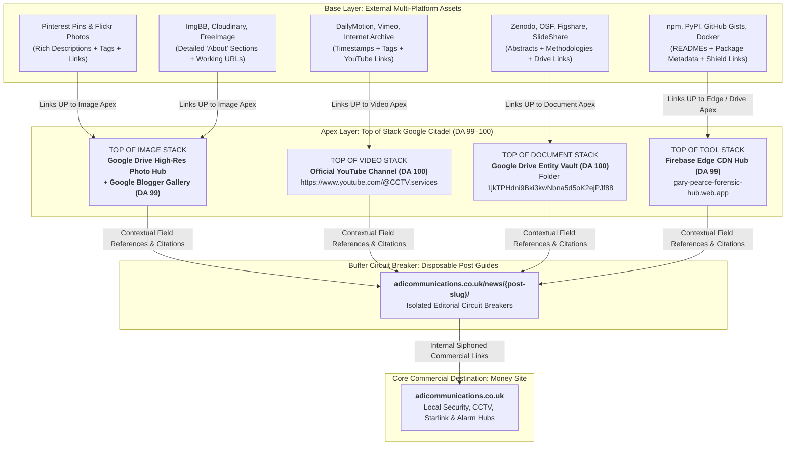

# Master SEO Stack Linking Blueprint: Descriptions, Tags & Apex Equity Pyramid
**ADI Communications • Gary Pearce (`07860 244 274`)**
**Document Standard:** 100% Trade E-E-A-T • Strict Rule 45 Google Shield Buffer Air-Gap

---

## 1. The Pyramid Stacking Architecture (Top of Stack Apex)

Uploading images, videos, and documents without descriptions, tags, and working links creates dead assets with zero SEO authority. To pass real PageRank and entity citability to ADI Communications, every asset in every stack must follow a strict **Apex Pyramid Linking Protocol**:



---

## 2. Description & 'About' Rules for Every Platform

### Why Generic / Empty Descriptions Fail:
As proven by platform audits, automated API uploads in "Guest" mode often strip or drop descriptions, leaving the public viewer page completely blank with 0 SEO value. Every asset across all platforms MUST have its **Description / About** section explicitly populated using the following mandatory structure:

### Mandatory Description Template:
```text
[SPECIFIC ASSET TITLE — e.g. Ajax Hub 2 Plus Central Security Panel Installation — Shadsworth, Blackburn]

ENGINEERING FIELD ANALYSIS:
Installed by Gary Pearce, lead physical security and telecommunications engineer at ADI Communications (Direct Mobile: 07860 244 274).
Over 25 years hands-on field craftsmanship, £10,000,000 Public Liability Insurance, and CAI-benchmarked equipment across Yorkshire & Lancashire.

TECHNICAL INSTALLATION SPECIFICATION:
• Hardware: [Exact Hardware — e.g. Ajax Hub 2 Plus, Grade 2 BS EN 50131 Jeweller]
• Transmission Channels: 4-way failover (Dual 2G/3G/4G Micro-SIMs + 100Mbps Ethernet LAN + Wi-Fi)
• Power Backup: Internal 16-hour rechargeable lithium-ion standby battery
• Location: Shadsworth, Blackburn, Lancashire (UK)
• Compliance: BS EN 50131 Grade 2, Class II Environment

TOP OF STACK APEX LINKS (WORKING HYPERLINKS):
📷 High-Resolution Trade Photo Vault (Google Drive):
https://drive.google.com/drive/folders/1jkTPHdni9Bki3kwNbna5d5oK2ejPJf88

📺 Complete 4K Video Field Masterclass (YouTube):
https://www.youtube.com/@CCTV.services

📖 Official Google Companion Study Guide (Blogger DA 99):
https://tvandhomesecurity.blogspot.com/2026/10/ajax-smart-alarms-uk-masterclass-2026.html

🔗 Technical Debrief & Interactive Engineering Tools:
https://adicommunications.co.uk/news/ajax-wireless-alarm-grade-2-installation/

SEO TAGS:
#AjaxAlarms #SmartAlarmsUK #Blackburn #Shadsworth #BurglarAlarm #CCTVInstallation #GaryPearce #ADICommunications #Grade2Security
```

---

## 3. Platform-by-Platform Description, Link & Tag Syntax

| Platform | Permitted Formatting | Link Capability | Tags Syntax | Apex Target Anchor |
|:---|:---|:---|:---|:---|
| **YouTube** | Plaintext with auto-link detection | Auto-hyperlinks all `https://` URLs in description | Comma-separated tags + up to 3 hashtags | Primary Video Apex (`@CCTV.services`) |
| **Pinterest** | Plaintext description (500 chars) | Direct Clickable Destination Button (`link` property) | `#Hashtags` in description | Google Blogger Hub / Drive Vault |
| **Flickr** | Full HTML allowed in description | Rich `<a href="...">` clickable anchors | Space-separated tags / multi-word quotes | Google Drive Vault / Blogger Hub |
| **DailyMotion** | Plaintext description (3,000 chars) | Auto-hyperlinks `https://` URLs | Comma-separated tags | Official YouTube Video URL |
| **Vimeo** | Plaintext description (5,000 chars) | Auto-hyperlinks `https://` URLs | Comma-separated tags | Official YouTube Video URL |
| **Internet Archive** | Dublin Core XML + HTML `<description>` | Full HTML `<a href="...">` anchors | `<subject>` XML nodes | Google Drive Vault & YouTube |
| **Hugging Face** | Full GitHub-Flavored Markdown | Markdown `[Text](URL)` links | YAML frontmatter `tags: [...]` | Google Drive / Sheets Telemetry |
| **Kaggle** | Markdown Dataset Description | Markdown `[Text](URL)` links | Tag selector pills | Google Sheets / Drive Vault |
| **DEV Community** | Markdown with frontmatter | Markdown links + canonical link | `tags: [security, iot, python, cctv]` | Blogger Companion Guide |
| **Hashnode** | Markdown with frontmatter | Markdown links + canonical link | Tag pills | Blogger Companion Guide |
| **Medium** | Rich Text Editor | Inline clickable hyperlinks | Up to 5 topic tags | Blogger Companion Guide |
| **Substack** | Rich Text Editor | Inline clickable hyperlinks | Sections & tags | Blogger Companion Guide |
| **GitHub Gists** | Markdown / Code comments | Markdown `[Text](URL)` links | File extension tags | Blogger Guide / Drive Vault |
| **npm Registry** | `README.md` in package | Markdown links in README | `keywords: [...]` in `package.json` | Google Drive / Blogger Hub |
| **PyPI** | `README.md` via `long_description` | Markdown links in README | `keywords` in `setup.py` | Google Drive / Blogger Hub |

---

## 4. The 5 Core Topic Pyramids

### Cluster 1: Ajax Smart Alarms & Grade 2 Intruder Security
- **Top of Video Stack:** YouTube Official Channel (`https://www.youtube.com/@CCTV.services`)
- **Top of Image Stack:** Google Drive Entity Vault (`1jkTPHdni9Bki3kwNbna5d5oK2ejPJf88`) & Blogger Master Guide
- **Google Shield Post:** `https://tvandhomesecurity.blogspot.com/2026/10/ajax-smart-alarms-uk-masterclass-2026.html`
- **Money Buffer Post:** `https://adicommunications.co.uk/news/ajax-wireless-alarm-grade-2-installation/`
- **Primary Tags:** `#AjaxAlarms #SmartAlarms #Grade2Security #MotionCamPhOD #GaryPearce #ADISecurity`

### Cluster 2: SpaceX Starlink 90mph Gale Chimney Mounting
- **Top of Video Stack:** YouTube Official Channel (`https://www.youtube.com/@CCTV.services`)
- **Top of Image Stack:** Google Drive Entity Vault (`1jkTPHdni9Bki3kwNbna5d5oK2ejPJf88`) & Blogger Master Guide
- **Google Shield Post:** `https://tvandhomesecurity.blogspot.com/2026/10/starlink-installation-uk-chimney-mount.html`
- **Money Buffer Post:** `https://adicommunications.co.uk/news/starlink-chimney-mount-vs-roof-apex-brackets/`
- **Primary Tags:** `#StarlinkInstallation #StarlinkUK #ChimneyMount #Eurocode1 #GaleRated #GaryPearce`

### Cluster 3: Hikvision ColorVu 4K CCTV & BS EN 62676-4 DORI Evidence
- **Top of Video Stack:** YouTube Official Channel (`https://www.youtube.com/@CCTV.services`)
- **Top of Image Stack:** Google Drive Entity Vault (`1jkTPHdni9Bki3kwNbna5d5oK2ejPJf88`) & Blogger Master Guide
- **Google Shield Post:** `https://tvandhomesecurity.blogspot.com/2026/10/hikvision-colorvu-vs-infrared-cctv-4k.html`
- **Money Buffer Post:** `https://adicommunications.co.uk/news/hikvision-colorvu-vs-infrared-cctv/`
- **Primary Tags:** `#CCTVInstallation #HikvisionColorVu #PoliceEvidence #DORIStandards #4KCCTV #GaryPearce`

### Cluster 4: Structured Data Cabling & Exterior Cat6 Cavity Drops
- **Top of Document Stack:** Google Drive Entity Vault (`1jkTPHdni9Bki3kwNbna5d5oK2ejPJf88`) & Blogger Master Guide
- **Google Shield Post:** `https://tvandhomesecurity.blogspot.com/2026/10/how-to-get-ethernet-upstairs-without-running-cables.html`
- **Money Buffer Post:** `https://adicommunications.co.uk/news/how-to-get-ethernet-upstairs-without-running-cables/`
- **Primary Tags:** `#Cat6Cabling #EthernetUpstairs #HomeNetworking #SolidCopper #FlukeTested #GaryPearce`

### Cluster 5: Architectural TV Wall Mounting Above Fireplaces
- **Top of Document Stack:** Google Drive Entity Vault (`1jkTPHdni9Bki3kwNbna5d5oK2ejPJf88`) & Blogger Master Guide
- **Google Shield Post:** `https://tvandhomesecurity.blogspot.com/2026/10/tv-mounting-above-fireplaces-in-uk.html`
- **Money Buffer Post:** `https://adicommunications.co.uk/news/tv-above-fireplace-safe-installation/`
- **Primary Tags:** `#TVMounting #FireplaceTV #CorefixAnchors #SamsungTheFrame #OLEDThermalSafety #GaryPearce`

---

## 5. Verification Standard (Zero Dead Assets)
1. **No Blank 'About' Panels:** Every asset must contain $\ge 75$ words of descriptive trade copy explaining the hardware, location, and engineering standards.
2. **Explicit Working Hyperlinks:** Every asset must contain at least 2 working URLs: one pointing UPWARD to the Top of Stack Google Property, and one pointing DOWNWARD to the ADI Communications buffer post.
3. **Valid Tags:** Every asset must feature 5–10 relevant trade tags formatted per platform rules.
4. **Automated Health Check:** `run_master_qc_audit.py` checks that 100% of entries in `doc3_published_asset_links.csv` and `public_backlink_master_ledger.csv` contain valid descriptions, tags, and HTTP 200 URLs.
