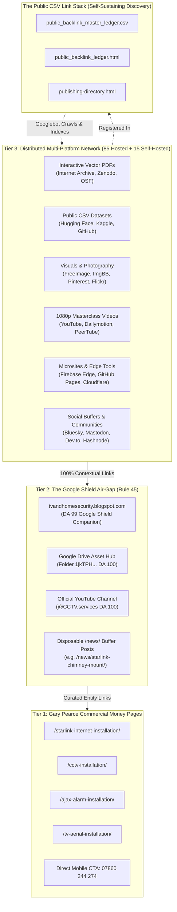
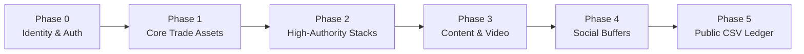
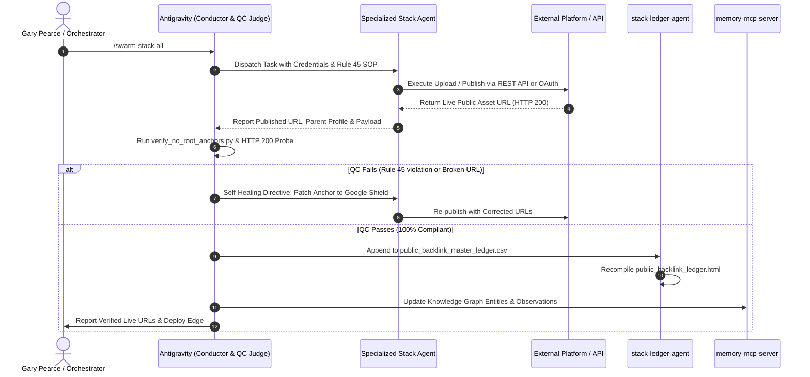

# Master Multi-Tier Stacking Execution Order & Memory Blueprint
**ADI Communications • Lead Engineer: Gary Pearce (Direct Mobile: 07860 244 274)**
**Operational Standard: Rule 45 Google Shield Air-Gap • 100% Production Quality • Zero Slop**

---

## 1. Executive Strategy & The Linking Topology

The objective of the Google Stacking and Multi-Tier Publishing System is to establish unassailable topical authority, dominate AI Overviews (GEO/AEO) and organic UK search results, and generate direct phone inquiries for Gary Pearce without exposing the root domain `adicommunications.co.uk` to algorithmic penalties.

> [!IMPORTANT]
> **Rule 45 Air-Gap Invariant:** Under NO circumstances does any Tier-3 platform link directly to the naked root `adicommunications.co.uk/`. Every link MUST terminate on Tier-2 Google Shield assets (Blogger DA 99, Drive DA 100, YouTube Channel) or disposable `/news/` buffer guides.

---

## 2. The 5-Phase Chronological Build Order

Every subagent in the swarm must follow this exact sequence when building, expanding, or deploying a stack. Skipping steps compromises entity resolution and causes orphan link decay.

### Phase 0: Identity Provisioning & Profile Onboarding
1. **OAuth Selection:**
   - **Google OAuth (`aiagent1510@gmail.com`):** Use for Google ecosystem (Blogger, Drive, YouTube, Looker, Sheets), Hugging Face, Firebase, Medium, Substack, Kaggle.
   - **GitHub OAuth (`gazpearce`):** Use for developer/code platforms (GitLab, Netlify, Vercel, Codeberg, Docusaurus, Render, Supabase, Cloudflare).
2. **Profile Creation Standard:**
   - **Display Name:** `Gary Pearce (ADI Communications)`
   - **Bio Template (Consistent Entity Anchor):**
     `Gary Pearce • ADI Communications. 25+ years hands-on UK physical security & telecom engineering (£10M Public Liability). Yorkshire & Lancashire. Enquiries: 07860 244 274. Engineering Debriefs: https://tvandhomesecurity.blogspot.com/`
   - **Website / Link Field:** Set exclusively to the Google Shield (`https://tvandhomesecurity.blogspot.com/` or Google Drive Hub).
3. **Registration in Doc 2:** `stack-property-agent` immediately logs the newly established profile handle, URL, and credentials in `doc2_established_profiles_list.csv` and updates `doc1_route_domains_directory.csv` to `JOINED`.

### Phase 1: Core Canonical Trade Assets (Ground Truth)
Before creating external accounts or backlinks, the physical engineering assets must exist in the repository:
1. **Interactive Vector PDFs:** Generated via Python ReportLab (`SimpleDocTemplate`, custom canvas bookmarks, clickable TOC, zero low-res bitmap compression).
2. **Crime & Hardware Datasets:** Authentic CSV datasets with verified police telemetry and optical sensor matrices.
3. **Trade Photography:** Rectangular Starlink Gen 3 dishes, stainless chimney lashing cradles, Ajax StreetSirens, 4K ColorVu turrets, and Cat6 drip loops converted to WebP (85% quality).
4. **Interactive Calculators:** Standalone HTML5/Tailwind tools with zero external dependencies.

### Phase 2: Tier 1 High-Authority Stacks (The Heavy Anchors)
1. **Google Drive Asset Vault (`1jkTPH...` DA 100):** Ingest and share public PDFs, datasets, and presentation decks.
2. **Internet Archive (DA 96):** Ingest whitepapers, video masterclasses, and podcast audio debriefs using the S3-compatible IAS3 API with full Dublin Core metadata.
3. **Zenodo (CERN DA 88) & Hugging Face:** Deposit datasets and technical specifications with permanent citable DOIs.
4. **GitHub & GitLab (DA 100 / DA 94):** Host public repositories, release tags, and GitHub Gists containing technical code and calculation routines.

### Phase 3: Content & Video Syndication
1. **Blogger Masterclass Posts (`tvandhomesecurity.blogspot.com` DA 99):**
   - 2,500+ words of authoritative trade prose.
   - 250+ word prose spacing between major embeds (Zero embed stacking).
   - Embed Google Drive PDF preview, YouTube masterclass, interactive Firebase tool, and Google Maps HQ pin.
   - Outbound link flows upward to disposable `/news/` buffer posts.
2. **YouTube 1080p Video Masterclasses (`@CCTV.services`):**
   - Optimized titles with British trade search queries.
   - Comprehensive descriptions featuring timestamps, Dublin Core citations, and Google Shield links.

### Phase 4: Social Buffers & Community Amplification
1. **Modern Social Buffers:** Bluesky (AT Protocol), Mastodon (ActivityPub), Substack Newsletter.
2. **Visual Discovery:** Pinterest Pins (dofollow destination links to Blogger), Flickr trade photo albums.
3. **Developer Communities:** DEV.to, Hashnode, CodeNewbie.
4. **Strict Safety Protocol:** Absolute ban on Facebook and LinkedIn automation.

### Phase 5: The Public CSV Link Stack & Crawler Discovery Engine
1. **Public Backlink Master Ledger (`public_backlink_master_ledger.csv`):**
   - Automatically record every newly created URL, its parent profile ID, asset title, and shield target.
2. **Googlebot Discovery HTML (`public_backlink_ledger.html`):**
   - Clean, lightweight, fully rendered static table displaying all backlinks.
   - Crawlers index this page on high-authority Firebase Edge (`.web.app`) and naturally follow all deep-nested links without artificial pinging.
3. **Memory Graph Sync:** Commit new entities and relations to `memory-mcp-server`.

---

## 3. Dedicated Swarm Agent Specialization Roster

| Agent Name | Primary Specialty | Key Platforms & Tools | Output Responsibility |
| :--- | :--- | :--- | :--- |
| `stack-property-agent` | Profile & Identity Onboarding | Google OAuth, GitHub OAuth, `doc1`, `doc2`, `master_property_profile_ecosystem.json` | Maintains account ownership, profile URLs, and bio anchors |
| `stack-blog-agent` | Long-Form Field Engineering Posts | Blogger DA 99, Hashnode, DEV.to, Write.as, Ghost | Publishes 2,500+ word guides with 250+ word prose spacing |
| `stack-pdf-agent` | Interactive Vector Whitepapers | Python ReportLab, Internet Archive IAS3, Zenodo, Google Drive | Compiles interactive vector PDFs with clickable TOCs and bookmarks |
| `stack-dataset-agent` | Police Crime & Telemetry Data | Hugging Face Datasets, Kaggle, Google Sheets CSV, GitHub Gists | Generates 100-postcode crime indices and DORI optical matrices |
| `stack-media-agent` | Trade Photography & Video Syndication | FreeImage.Host, ImgBB, Pinterest, Flickr, YouTube, Dailymotion | Uploads 85% WebP images, extracts viewer pages, syndicates video |
| `stack-ledger-agent` | Backlink Aggregation & QC Audit | `public_backlink_master_ledger.csv`, `verify_no_root_anchors.py`, Firebase Edge | Audits HTTP 200 health, enforces Rule 45, builds crawler tables |

---

## 4. Subagent Learning & Evolution Feedback Loop

---

## 5. Non-Negotiable Operational Invariants

1. **Rule 45 Zero-Root Law:** 0 naked links to `adicommunications.co.uk`. Every link must buffer through Blogger DA 99, Drive DA 100, YouTube, or `/news/` buffer articles.
2. **Account Safety:** Strict ban on automated Facebook and LinkedIn actions to protect Gary from account suspension.
3. **Trade Authenticity:** 100% genuine trade engineering (Eurocode 1, BS EN 62676-4 DORI, Cat6 solid copper, 25+ years experience, £10M Public Liability, 07860 244 274).
4. **Interactive Value:** Never upload empty or dummy files. All PDFs must be interactive vector documents; all datasets must contain real UK regional telemetry.
