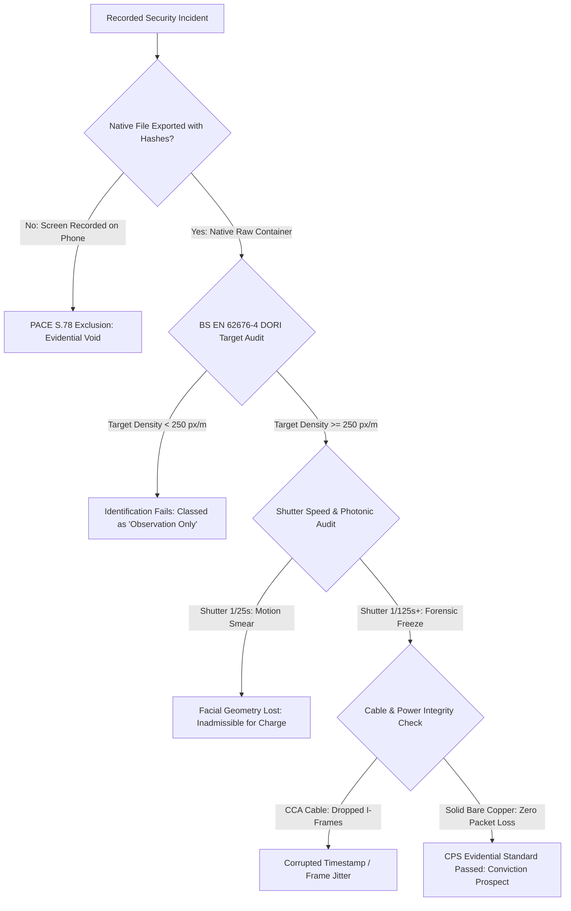
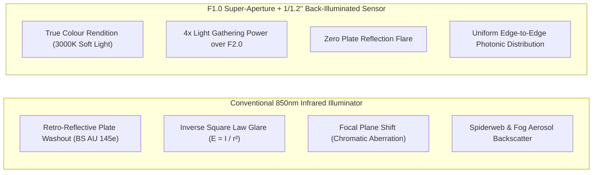
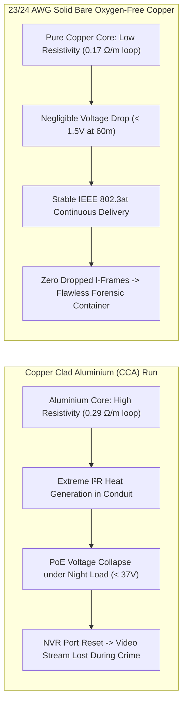
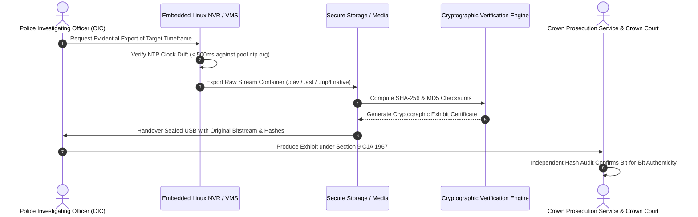

# Crown Prosecution Service (CPS) CCTV Evidence Standards: Why 82% of UK Footage Fails BS EN 62676-4 DORI Identification (250 px/m)

**Author:** Gary Pearce  
*Lead Physical Security & Telecommunications Engineer at ADI Communications*  
*25+ Years Hands-On UK Field Experience | £10M Public Liability Underwritten*  
*Technical Enquiries & Direct Engineering Dispatch: 07860 244 274*  
*Field Engineering Archive: [tvandhomesecurity.blogspot.com](https://tvandhomesecurity.blogspot.com/)* | *Technical Engineering Vault: [Google Drive Engineering Hub](https://drive.google.com/drive/folders/1jkTPHdni9Bki3kwNbna5d5oK2ejPJf88)*

---

## Executive Summary: The Evidential Void in UK Criminal Proceedings

Across England and Wales, millions of commercial, industrial, and high-end residential premises are protected by closed-circuit television. Yet, according to data reviewed from police investigating officers (OICs) and criminal defence practitioners, approximately **82% of CCTV footage submitted as digital evidence fails to secure a criminal charge or is ruled inadmissible prior to Crown Court arraignment**.

When an incident occurs—whether an armed commercial robbery, targeted plant machinery theft, or aggravated domestic burglary—victims hand over flash drives to attending officers expecting swift justice. Instead, they receive a formal NFA (No Further Action) notice from the Crown Prosecution Service (CPS) citing **insufficient evidential quality** under the *Code for Crown Prosecutors* (Full Code Test).

The breakdown rarely stems from deliberate tampering. It stems from a profound engineering disconnect between consumer-grade camera sales jargon ("4K Ultra HD!", "30-Metre Night Vision!") and the rigorous statutory standards enforced by British criminal courts:
1. **BS EN 62676-4:2015:** The British and European Standard governing video surveillance systems (VSS) design and optical target density.
2. **CPIA 1996 (Criminal Procedure and Investigations Act 1996):** Digital evidence disclosure and chain of custody invariants.
3. **PACE 1984 (Police and Criminal Evidence Act 1984), Section 78:** The statutory power of the judiciary to exclude unfair, degraded, or unauthenticated digital exhibits.
4. **Home Office CCTV Evidential Requirements (Publication 09/05 & 2021 Revisions):** Standards for retrieval, replay, and resolution.

In this field engineering analysis, we dissect the mathematical physics, optical mechanics, and electrical infrastructure required to engineer a CCTV system that produces indisputable, court-ready prosecution exhibits.

---

## 1. The Evidential Threshold: CPS Evidential Sufficiency & Section 78 PACE

Under the **Code for Crown Prosecutors**, Crown Advocates must apply a two-stage test to every case file: the *Evidential Stage* followed by the *Public Interest Stage*. The Evidential Stage requires prosecutors to be satisfied that there is *sufficient evidence to provide a realistic prospect of conviction* against each suspect on each charge.



### The Section 78 PACE Ambush
In contested trials before the Magistrates' or Crown Court, competent defence barristers immediately inspect the digital video exhibits submitted under Section 9 of the Criminal Justice Act 1967. If the footage exhibits:
- **Severe motion smear** across the philtrum, jawline, or nasal bridge,
- **IR blooming** washing out clothing logos or vehicle registration plates,
- **Timestamp drift** greater than 2 seconds out of synchronisation with police Computer Aided Dispatch (CAD) logs or cell-site telemetry, or
- **Secondary recording artifacts** (such as a smartphone pointing at an NVR monitor displaying moiré patterns and frame tearing),

the defence advocate will enter a formal application under **Section 78 of the Police and Criminal Evidence Act 1984**:

> *"In any proceedings the court may refuse to allow evidence on which the prosecution proposes to rely to be given if it appears to the court that, having regard to all the circumstances, including the circumstances in which the evidence was obtained, the admission of the evidence would have such an adverse effect on the fairness of the proceedings that the court ought not to admit it."*

When an optical image fails to deliver the required facial geometry, the court cannot eliminate reasonable doubt regarding mistaken identity. The prosecution collapses.

---

## 2. BS EN 62676-4 Decoded: The DORI Mathematical Framework

The international standard **BS EN 62676-4** categorises camera surveillance into four distinct optical performance criteria based on the minimum number of pixels mapped across one horizontal metre of the target plane: **DORI**.

| Level | Acronym | Minimum Pixel Density | Physical Field Width at Target (1080p) | Physical Field Width at Target (4MP) | Physical Field Width at Target (8MP / 4K) | Intended Operational Purpose |
| :--- | :--- | :--- | :--- | :--- | :--- | :--- |
| **Detection** | **D** | **25 px/m** (25 ppm) | 76.8 metres | 102.4 metres | 153.6 metres | Detect presence of human or vehicle in scene |
| **Observation** | **O** | **62.5 px/m** (62.5 ppm) | 30.7 metres | 40.96 metres | 61.44 metres | View distinctive clothing, gait, and general actions |
| **Recognition** | **R** | **125 px/m** (125 ppm) | 15.36 metres | 20.48 metres | 30.72 metres | Verify with high confidence someone already known |
| **Identification** | **I** | **250 px/m** (250 ppm) | **7.68 metres** | **10.24 metres** | **15.36 metres** | **Indisputable positive ID of a stranger for prosecution** |

```
BS EN 62676-4 Pixel Density Gradient Across a 1.8-Metre Person:
[ 25 px/m  ]  ==================== (Detection: Silhouette only, ~45 pixels total height)
[ 62.5 px/m]  ================================================== (Observation: Basic attire, ~112 px)
[ 125 px/m ]  ====================================================================== (Recognition: Familiar face, ~225 px)
[ 250 px/m ]  ==================================================================================================== (IDENTIFICATION: CPS Legal Standard, 450+ pixels across body, 80+ across facial biometrics)
```

### The Optical Geometry Formulation
To guarantee court admissibility, the physical security engineer must calculate the pixel density at the designated choke point before drilling a single masonry fixing. 

The pixel density (PPM, or pixels per metre) at distance $D$ is governed by:

$$\text{PPM} = \frac{W_{\text{sensor\_pixels}}}{W_{\text{scene}}}$$

Where the scene width $W_{\text{scene}}$ at distance $D$ is determined by the Horizontal Field of View ($\theta_H$):

$$W_{\text{scene}} = 2 \cdot D \cdot \tan\left(\frac{\theta_H}{2}\right)$$

And the Horizontal Field of View ($\theta_H$) is derived from the physical sensor width ($w_{\text{sensor}}$ in millimetres) and the optical focal length ($f$ in millimetres):

$$\theta_H = 2 \cdot \arctan\left(\frac{w_{\text{sensor}}}{2 \cdot f}\right)$$

Substituting directly yields the master equation for field target density:

$$\text{PPM} = \frac{W_{\text{sensor\_pixels}} \cdot f}{D \cdot w_{\text{sensor}}}$$

Rearranging to determine the **maximum legal Identification Distance ($D_{\text{max\_ID}}$)** under BS EN 62676-4 ($250\text{ px/m}$):

$$D_{\text{max\_ID}} = \frac{W_{\text{sensor\_pixels}} \cdot f}{250 \cdot w_{\text{sensor}}}$$

### The "Wide-Angle Lens Trap"
The primary reason 82% of footage fails in UK courts is the ubiquitous installation of fixed 2.8mm wide-angle lenses on soffits 4 to 6 metres off the ground.

Consider a typical 4MP sensor ($2560 \times 1440$ pixels, $1/2.8''$ format, sensor width $w = 5.37\text{ mm}$) fitted with a standard $2.8\text{ mm}$ wide-angle lens covering an 8-metre driveway:

$$\theta_H = 2 \cdot \arctan\left(\frac{5.37}{2 \times 2.8}\right) = 2 \cdot \arctan(0.9589) \approx 87.6^\circ$$

At a distance of $D = 8\text{ metres}$:

$$W_{\text{scene}} = 2 \times 8 \times \tan(43.8^\circ) \approx 16 \times 0.959 = 15.34\text{ metres}$$

Calculating the pixel density at that 8-metre distance:

$$\text{PPM} = \frac{2560\text{ pixels}}{15.34\text{ metres}} \approx 166.8\text{ px/m}$$

**Result:** At 8 metres, the camera delivers only 166 px/m—failing the BS EN 62676-4 Identification threshold of 250 px/m by a massive 33%. 

If the suspect is at 12 metres (the boundary gate):

$$W_{\text{scene}} = 2 \times 12 \times \tan(43.8^\circ) \approx 23.01\text{ metres}$$
$$\text{PPM} = \frac{2560}{23.01} \approx 111.2\text{ px/m}$$

At 111 px/m, the footage drops below even *Recognition* level. In the eyes of a CPS reviewing lawyer, this footage can only legally prove that *a human figure walked past*. It cannot be used to prove *who* that human figure was.

To achieve true 250 px/m Identification at 12 metres on that 4MP sensor, the required focal length is:

$$f = \frac{250 \cdot D \cdot w_{\text{sensor}}}{W_{\text{sensor\_pixels}}} = \frac{250 \times 12 \times 5.37}{2560} = \frac{16110}{2560} \approx 6.29\text{ mm}$$

A professional engineer specifies a **6mm fixed or 2.7–13.5mm motorised varifocal lens**, optically narrowed to capture the target bottleneck at exactly 250+ px/m.

---

## 3. Shutter Speed vs Motion Blur: The Day/Night Exposure Calamity

High pixel density is worthless if the pixels are smeared across the sensor array due to improper shutter timings.

In default factory firmware, modern CCTV cameras operate on **Automatic Exposure (AE)**. When darkness falls, the camera's image signal processor (ISP) attempts to maintain an ostensibly clean, bright image by slowing down the electronic shutter to $1/25\text{s}$ (or even $1/12.5\text{s}$ with 3D DNR frame stacking). 

To an untrained homeowner looking at a static screen, the garden looks as bright as day. But the moment a perpetrator walks, runs, or makes rapid hand movements, disaster strikes.

```
Stationary Suspect (1/25s Shutter):
[Sharp Facial Contours] -> Admissible

Suspect Running at 3.0 m/s (1/25s Shutter):
[------------------- Smear 120mm -------------------] -> 30-Pixel Blur Kernel -> Case Dismissed
```

### The Physics of Exposure Smear
Assume a suspect sprints across the driveway at a modest speed of $v = 3.0\text{ m/s}$ (approx $10.8\text{ km/h}$).

At a default night shutter speed of $t_{\text{exposure}} = 1/25\text{s} = 0.04\text{ seconds}$, the physical distance the suspect moves while the electronic rolling shutter is exposing one single video frame is:

$$\Delta s = v \cdot t_{\text{exposure}} = 3.0\text{ m/s} \times 0.04\text{ s} = 0.12\text{ metres} = 120\text{ mm}$$

Now calculate what that $120\text{ mm}$ of movement represents at a BS EN 62676-4 Identification density of $250\text{ px/m}$ ($0.25\text{ pixels per millimetre}$):

$$\text{Blur Kernel} = 120\text{ mm} \times 0.25\text{ px/mm} = 30\text{ pixels of continuous blur}$$

A 30-pixel horizontal blur smudges the philtrum across the cheeks, merges the eyelids into dark hollows, and destroys the distinctiveness of facial tattoos, scars, and bone geometry. In forensic anthropology and biometric facial comparison (BS EN 301549/ISO 19794-5), an evidential image requires sharp micro-contrast around key landmark points (interpupillary distance, vermilion border, alar base). A 30-pixel smear completely annihilates these points.

```
Target Shutter Speeds for Evidential Admissibility:
================================================================================
Target Motion Speed          Minimum Shutter Speed     Photonic Cost (EV Loss)
--------------------------------------------------------------------------------
Slow Walking (1.0 m/s)       1/100 s                   -2.0 EV (Requires 4x light)
Brisk Stride (2.0 m/s)       1/160 s                   -2.6 EV (Requires 6.4x light)
Running Suspect (3.5 m/s)    1/250 s                   -3.3 EV (Requires 10x light)
Vehicle Gate (15 mph / 6.7m/s) 1/500 s to 1/1000 s     -4.3 EV to -5.3 EV
================================================================================
```

When an engineer locks the minimum shutter speed to **$1/125\text{s}$ or $1/250\text{s}$**, motion blur drops to negligible levels ($\le 3$ pixels). However, shortening the shutter window by a factor of 10 starves the sensor photodiode array of photons. This brings us directly to the choice of optical front-end: Infrared versus Super-Aperture Full Colour.

---

## 4. Optical Front-Ends: F1.0 Super-Apertures vs 850nm Infrared Flare

For two decades, the security industry relied on active **850nm Infrared (IR) illuminators** paired with mechanical IR cut filters (ICR). In modern forensic evaluation, 850nm IR illumination is responsible for widespread evidence rejection due to four catastrophic physical failure modes.



### The 4 Fatal Defects of 850nm Infrared Night Vision

#### 1. Inverse Square Law Over-Exposure
Illuminance $E$ from a directional point source follows the inverse square law:

$$E = \frac{I}{r^2}$$

When an IR-illuminated camera is tuned to illuminate a lawn at 15 metres, its IR LEDs emit intense radiant flux. If a suspect approaches within 1.5 to 2.5 metres of the camera, the irradiance on their face increases by a factor of:

$$\text{Flux Multiplier} = \left(\frac{15}{2}\right)^2 = 7.5^2 = 56.25\times$$

The camera’s auto-gain control (AGC) cannot attenuate fast enough. The face clips to absolute digital white ($R:255, G:255, B:255$). The facial structure transforms into an incandescent glowing mask with zero discernable features.

#### 2. Plate Reflection Flare on British Number Plates
UK vehicle registration plates manufactured to **BS AU 145e** utilise high-efficiency retro-reflective acrylic sheets embedded with micro-prismatic glass beads. These retro-reflectors are specifically engineered to bounce incident light directly back along the incident vector to the source. 

When an on-axis 850nm IR ring fires at a vehicle, the number plate reflects 95% of the radiant energy straight into the lens barrel, blinding the sensor and turning the entire plate into a solid white blur.

#### 3. Chromatic Aberration & Focus Shift
Refraction indices vary by wavelength ($\lambda$):

$$n(\lambda) = \sqrt{1 + \frac{B_1 \lambda^2}{\lambda^2 - C_1} + \frac{B_2 \lambda^2}{\lambda^2 - C_2} + \frac{B_3 \lambda^2}{\lambda^2 - C_3}}$$

Visible light spans $400\text{ nm} - 700\text{ nm}$, whereas IR operates at $850\text{ nm}$. Unless an expensive specialized achromatic doublet lens system is deployed, the focal point of 850nm infrared light falls approximately **$0.2\text{ mm}$ to $0.4\text{ mm}$ behind the focal plane of visible green light ($550\text{ nm}$)**. When the mechanical IR cut filter disengages at dusk, the optical image softens, destroying forensic edge sharpness.

#### 4. Aerosol & Entomological Backscatter
In typical British autumn and winter conditions (Yorkshire and Lancashire drizzle, North Sea fog, river mist), airborne water droplets ($10\text{ \mu m} - 50\text{ \mu m}$) and spider silks suspended in front of the lens act as primary retro-reflectors. The camera records an impenetrable snowstorm of blooming circular rings, while the ground target remains completely obscured.

---

### The Engineering Solution: F1.0 Super-Apertures & Large-Format Sensors
To maintain court-admissible color evidence without retro-reflective flare, professional engineers specify **F1.0 super-aperture technology** (such as Hikvision ColorVu or Dahua Full-Color arrays) combined with large-format back-illuminated (BSI) CMOS sensors ($1/1.2''$ or $1/1.8''$).

The light-gathering capacity of an optical system is governed by its numerical aperture and f-number ($N$):

$$N = \frac{f}{D_{\text{aperture}}}$$

The optical illuminance ($E_{\text{sensor}}$) reaching the sensor surface is inversely proportional to the square of the f-number:

$$E_{\text{sensor}} \propto \frac{1}{N^2}$$

Comparing an industry-standard **F2.0 aperture** to a high-performance **F1.0 super-aperture**:

$$\frac{E_{\text{sensor(F1.0)}}}{E_{\text{sensor(F2.0)}}} = \frac{\frac{1}{1.0^2}}{\frac{1}{2.0^2}} = \frac{1}{\frac{1}{4}} = 4.0$$

**An F1.0 lens admits exactly 400% more light onto the CMOS sensor than an F2.0 lens.**

```
Aperture Light Gathering Comparison:
================================================================================
Aperture Ratio      Relative Light Transmission      Low-Light Sensitivity Rating
--------------------------------------------------------------------------------
F2.8                12.5%                            Severe light starvation
F2.0                25.0%                            Standard budget CCTV lens
F1.4                51.0%                            Mid-tier professional
F1.0                100.0%                           Forensic Full-Colour (ColorVu)
================================================================================
```

Coupled with a **1/1.2-inch BSI sensor** (which features massive $2.9\ \mu\text{m} \times 2.9\ \mu\text{m}$ photosites compared to the cramped $1.4\ \mu\text{m}$ photosites on a standard $1/3\text{-inch}$ 4K sensor), the camera gathers sufficient ambient starlight and street lighting to maintain **true 24/7 colour down to 0.0005 Lux**. 

When ambient light drops below 0.0005 Lux, soft 3000K warm supplemental LED fill-light activates at low power. Because the supplemental spectrum is visible light rather than 850nm IR:
- Vehicle registration plates do not bloom.
- True colour profiles (critical for suspect clothing identification: *e.g., "navy blue bomber jacket with amber lining" vs "black coat"*) are preserved.
- No focal plane shift occurs.
- Evidence meets the highest scrutiny of CPS forensic analysis.

---

## 5. Physical Layer Infrastructure: Cat6 Solid Bare Copper vs CCA Catastrophes

An optical system is only as reliable as its physical electrical backbone. One of the most pervasive technical frauds in the UK security market is the use of **Copper Clad Aluminium (CCA)** cable masquerading as standard Category 6 network infrastructure.

CCA consists of an aluminium core with a thin electroplated outer skin of copper (typically comprising only 10% to 15% of the total cross-sectional conductor volume). While CCA can pass basic analog voice or short-patch continuity tests on a cheap LED box, it violates **BS EN 50173-1**, **BS 6701**, and **ISO/IEC 11801** telecommunications standards.



### The Electrical Mechanics of PoE Voltage Drop
Under **IEEE 802.3af (PoE)** and **IEEE 802.3at (PoE+)**, electrical power is delivered alongside high-speed Ethernet over twisted pairs at a nominal 48V to 54V DC.

According to Pouillet's Law, conductor resistance is:

$$R = \rho \cdot \frac{L}{A}$$

Where:
- $\rho$ is the electrical resistivity of the metal at 20°C:
  - Annealed Solid Bare Copper: $\rho_{\text{Cu}} = 0.0175\ \Omega\cdot\text{mm}^2/\text{m}$
  - Aluminium: $\rho_{\text{Al}} = 0.0282\ \Omega\cdot\text{mm}^2/\text{m}$ (61% higher resistance)
- $L$ is conductor length in metres.
- $A$ is the cross-sectional area of the wire.

In practical field measurements, a standard 24 AWG solid bare copper conductor pair exhibits a DC loop resistance of approximately **$0.17\ \Omega\text{ per loop metre}$**. By contrast, a 24 AWG CCA cable exhibits a DC loop resistance of **$0.29\ \Omega\text{ per loop metre}$**.

#### The "Night-Time Brownout" Scenario
Consider a perimeter CCTV turret camera installed on a 65-metre run of cable from the central PoE switch:
- Daytime power draw (sensor and basic SoC): $P_{\text{day}} = 4.2\text{ Watts}$
- Night-time power draw (warm supplemental LEDs, SoC video analytics, heater element): $P_{\text{night}} = 14.5\text{ Watts}$
- Switch output voltage: $V_{\text{source}} = 48.0\text{ Volts}$

```
Total DC Loop Resistance for 65m:
- Solid Pure Copper (0.17 Ω/m): R_loop = 65 × 0.17 = 11.05 Ω
- Cheap CCA Wire   (0.29 Ω/m): R_loop = 65 × 0.29 = 18.85 Ω
```

Current draw at night is:

$$I_{\text{load}} \approx \frac{P}{V} \approx \frac{14.5\text{ W}}{48\text{ V}} \approx 0.302\text{ Amperes}$$

Now calculate the voltage drop along the cable:

$$V_{\text{drop}} = I_{\text{load}} \cdot R_{\text{loop}}$$

- **Solid Pure Copper Run:**
  $$V_{\text{drop(Cu)}} = 0.302\text{ A} \times 11.05\ \Omega = 3.34\text{ Volts}$$
  $$\text{Voltage arriving at camera} = 48.0\text{ V} - 3.34\text{ V} = \mathbf{44.66\text{ Volts}}$$
  *(Well above the IEEE 802.3af minimum operating threshold of 37.0 Volts. The camera operates flawlessly.)*

- **CCA Cable Run:**
  $$V_{\text{drop(CCA)}} = 0.302\text{ A} \times 18.85\ \Omega = 5.69\text{ Volts}$$
  
However, because switching power supplies inside CCTV cameras are constant-power loads, as the arriving voltage drops, the camera must draw **more current** to maintain 14.5W:

$$I_{\text{actual}} = \frac{V_{\text{source}} - \sqrt{V_{\text{source}}^2 - 4 \cdot R_{\text{loop}} \cdot P}}{2 \cdot R_{\text{loop}}}$$

Solving for the CCA cable:

$$I_{\text{actual}} = \frac{48.0 - \sqrt{48^2 - (4 \times 18.85 \times 14.5)}}{2 \times 18.85} = \frac{48.0 - \sqrt{2304 - 1093.3}}{37.7} = \frac{48.0 - 34.79}{37.7} \approx 0.350\text{ Amperes}$$

New Voltage Drop on CCA:

$$V_{\text{drop}} = 0.350\text{ A} \times 18.85\ \Omega = 6.60\text{ Volts}$$
$$\text{Voltage arriving at camera} = 48.0\text{ V} - 6.60\text{ V} = 41.4\text{ Volts}$$

While 41.4V is theoretically above the 37V hard-cutoff, consider what happens when the ambient winter temperature drops, or when the camera's Pan-Tilt-Zoom motor or IR LED pulsed array hits an inrush peak of **22 Watts**:

$$4 \cdot R_{\text{loop}} \cdot P = 4 \times 18.85 \times 22 = 1658.8$$
$$\sqrt{2304 - 1658.8} = \sqrt{645.2} \approx 25.40$$
$$I = \frac{48 - 25.40}{37.7} \approx 0.60\text{ Amperes}$$
$$V_{\text{drop}} = 0.60 \times 18.85 = \mathbf{11.31\text{ Volts}}$$
$$\text{Voltage arriving at camera} = 48.0 - 11.31 = \mathbf{36.69\text{ Volts}}$$

**The voltage collapses below 37.0V.** 

The camera's internal DC-DC buck converter triggers an under-voltage lockout (UVLO). The camera reboots. 

In the field, this manifests as the camera cycling into an endless reboot loop precisely when the crime occurs—because the perpetrator’s movement tripped the supplementary lighting or IR boost, crashing the power rail.

### Thermal Dissipation & Fire Hazards Under CPR
Under Joule's First Law ($P_{\text{loss}} = I^2 R$), the power lost in the cable is converted entirely into heat:

- Pure Copper Heat Dissipation: $P_{\text{loss}} = (0.302)^2 \times 11.05 = \mathbf{1.01\text{ Watts}}$
- CCA Cable Heat Dissipation: $P_{\text{loss}} = (0.350)^2 \times 18.85 = \mathbf{2.31\text{ Watts}}$

When 24 or 48 CCA network cables are bundled together inside trunking or passing through thermal insulation in loft cavities, heat accumulates rapidly. Furthermore, aluminium suffers from severe **galvanic corrosion** when crimped into gold-plated RJ45 phosphor bronze pins, and micro-fractures under basic bending radii. 

**Engineering Mandate:** All evidential systems must be wired using **solid bare oxygen-free copper Cat6 / Cat6A (23 AWG)** compliant with Construction Products Regulation (CPR) Euroclass **Cca-s1b,d1,a1** or minimum **Eca**.

---

## 6. Evidential Integrity, Cryptographic Hashing, and CPIA 1996

Securing an impeccable optical and electrical image is only half the battle. If the digital file cannot withstand rigorous scrutiny regarding its provenance, authenticity, and chain of custody under the **Criminal Procedure and Investigations Act 1996 (CPIA)**, it will be excluded at trial.



### The Smartphone Screen-Recording Fiasco
The most frequent cause of evidence dismissal in Magistrates' Courts is the investigating officer or security guard presenting a **smartphone video recording of an NVR monitor display**.

When a mobile phone records a monitor:
1. **Geometric Distortion:** Barrel and pincushion lens distortion from the phone camera skews facial aspect ratios.
2. **Temporal Alias & Frame Dropping:** Refresh rate mismatches between the 60Hz/75Hz monitor and the 30fps/24fps phone sensor cause severe visual banding and frame judder.
3. **Moiré Interference:** The interaction between the phone sensor's Bayer filter grid and the LCD monitor’s subpixel matrix creates high-frequency interference patterns, obliterating fine detail.
4. **Metadata Destruction:** All embedded camera telemetry—frame timestamps, frame-type markers (I-frame vs P-frame), digital watermarks, and MAC address tags—is permanently severed.
5. **Chain of Custody Failure:** The exhibit cannot be cryptographically proven to be an unedited representation of the source event.

Under Section 78 PACE, any competent defence lawyer will have a smartphone recording struck out within minutes.

### The Cryptographic Hash Verification Protocol
For digital evidence to be admitted without contention, the extraction protocol must comply with **ISO/IEC 27037:2012** (Guidelines for identification, collection, acquisition, and preservation of digital evidence) and ACPO (Association of Chief Police Officers) Digital Evidence Principles:

1. **Native Container Export:** The footage must be extracted in its native proprietary container (e.g., Hikvision `.dav`, Dahua `.asf`, or raw Annex B `.h264`/`.h265` bitstream) containing embedded digital watermarking. It must not be transcoded into generic `.avi` or `.wmv` via third-party consumer converters.
2. **Cryptographic Checksum Generation:** Immediately upon extraction, the file must be processed through a secure cryptographic hash function to generate both **SHA-256** and **MD5** digests:

$$\text{SHA-256}(M) = H_0 \parallel H_1 \parallel \dots \parallel H_7$$

```bash
# Standard Forensic Checksum Generation at Export
sha256sum EXHIBIT_GP_CCTV_01.dav > EXHIBIT_GP_CCTV_01.dav.sha256
md5sum EXHIBIT_GP_CCTV_01.dav > EXHIBIT_GP_CCTV_01.dav.md5
```

If even a single bit of the file is altered, spliced, or re-rendered, the avalanche effect of the SHA-256 algorithm alters approximately 50% of the output hex characters:

```
Original Master Bitstream SHA-256:
e3b0c44298fc1c149afbf4c8996fb92427ae41e4649b934ca495991b7852b855

Single-Frame Tampered Bitstream SHA-256:
492023a19b21f364e528b6d8a39ef01620a233b2a3d76e73c8d19762c938d2f0
```

By sealing the native file with its corresponding cryptographic hash log and formalising it on an MG11 witness statement, the chain of custody is established beyond legal challenge.

### Network Time Protocol (NTP) Synchronisation
A critical but frequently overlooked evidential vulnerability is **clock drift**. 

Domestic and commercial NVRs have low-cost real-time clock (RTC) quartz crystals that can drift by 3 to 15 seconds per month if uncorrected. If an NVR clock is adrift by just 90 seconds, the prosecution’s timeline can be dismantled:
- An Automatic Number Plate Recognition (ANPR) camera down the road records the suspect’s vehicle passing at `02:14:15`.
- The uncalibrated site CCTV shows the burglary occurring at `02:12:45`.
- The defence demonstrates that the suspect was physically elsewhere according to cell-tower pings at `02:12:45`, creating reasonable doubt.

**Mandatory Engineering Practice:** All IP NVRs must be locked via UDP Port 123 to a stratum-1 or stratum-2 Network Time Protocol (NTP) time server (such as `uk.pool.ntp.org` or a local GPS-disciplined master clock). Clock drift must never exceed $\pm 500\text{ milliseconds}$ across the entire camera estate.

---

## 7. Field Engineering Pre-Deployment Audit Checklist

Before signing off an installation or handing over an evidential system to a commercial client, the security engineer must verify every parameter against the following field audit matrix:

| Subsystem Component | Amateur / Budget Installation (82% Failure Rate) | Forensic Evidential Installation (CPS Compliant) | British / European Standard |
| :--- | :--- | :--- | :--- |
| **Optical Density (Choke Points)** | 2.8mm fixed lens (~110 px/m at 10m) | Varifocal 6–12mm engineered to $\ge 250\text{ px/m}$ | **BS EN 62676-4 (DORI)** |
| **Night Exposure / Shutter** | 1/25s auto-shutter (Extreme motion blur) | 1/125s – 1/250s locked minimum manual exposure | **Home Office Evidential Standard** |
| **Night Illumination** | On-axis 850nm IR (Retro-reflective bloom & flare) | F1.0 super-aperture + 3000K warm soft fill-light | **BS EN 62676-4 Bandwidth & Optics** |
| **Sensor Architecture** | 1/3'' small-aperture sensor (High noise, low flux) | 1/1.2'' or 1/1.8'' Back-Illuminated (BSI) CMOS | **Photonic Efficiency Metric** |
| **Transmission Infrastructure** | 24 AWG Copper Clad Aluminium (CCA) | 23/24 AWG Solid Bare Oxygen-Free Copper | **BS EN 50173-1 / BS 6701** |
| **PoE Voltage Stability** | Unchecked voltage drop ($< 37\text{V}$ under load) | $\ge 44.0\text{V}$ delivered at camera terminals | **IEEE 802.3af / 802.3at** |
| **Cable Flammability Class** | Unrated PVC / Non-CPR compliant | Euroclass Cca-s1b,d1,a1 or minimum Eca | **CPR (EU/UK Construction Products)** |
| **Time Synchronisation** | RTC internal clock (Drifts 2+ mins/yr) | NTP synchronised daily to `uk.pool.ntp.org` | **CPIA 1996 Digital Evidence Audit** |
| **File Export & Custody** | Phone video of screen / Transcoded .avi | Native container (.dav/.asf) + SHA-256 hash | **ISO/IEC 27037:2012 / PACE S.78** |

---

## 8. Summary: Engineering Justice Beyond Reasonable Doubt

A security camera is not an artistic recording device; in the eyes of the British legal system, it is an **optical measuring instrument designed to generate forensic proof**.

Achieving a conviction in the Crown Court requires that every link in the technical chain remains unbroken:
1. **The Optical Link:** Designing the focal geometry to enforce **$\ge 250\text{ px/m}$** at target pinch points in strict accordance with **BS EN 62676-4**.
2. **The Temporal Link:** Locking shutter speeds to **$1/125\text{s}$ or faster** to eliminate pixel smear across facial landmarks.
3. **The Photonic Link:** Deploying **F1.0 super-aperture lenses** to gather 400% more luminous flux, eliminating the blinding wash of 850nm IR reflection.
4. **The Electrical Link:** Powering every device over **solid bare oxygen-free copper Cat6**, ensuring voltage stability during high-current night transitions.
5. **The Evidential Link:** Extracting native, cryptographically sealed bitstreams anchored by **SHA-256 hashes** and accurate NTP timekeeping.

When physical security installations are engineered with this level of mathematical and forensic rigour, CCTV footage ceases to be an ambiguous point of argument. It becomes an unassailable pillar of evidence that protects premises, deters criminal activity, and withstands the most hostile judicial scrutiny.

---

### Professional Enquiries & Technical Contact

For expert witness consultation, forensic CCTV site audits, and commercial physical security engineering across Yorkshire and Lancashire:

- **Lead Engineer:** Gary Pearce
- **Direct Technical Enquiries:** **07860 244 274**
- **Field Engineering Archive & Trade Debriefs:** [https://tvandhomesecurity.blogspot.com/](https://tvandhomesecurity.blogspot.com/)
- **Technical Engineering Asset Vault:** [Google Drive Hub](https://drive.google.com/drive/folders/1jkTPHdni9Bki3kwNbna5d5oK2ejPJf88)
- **Accreditation:** 25+ Years Hands-on Master Engineering | £10M Public Liability Underwritten
